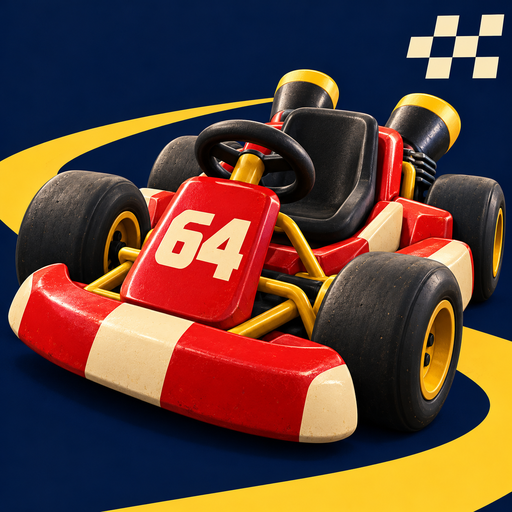
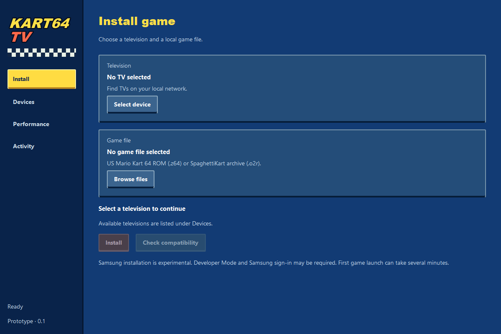

<p align="center"></p>
<h1 align="center">Kart64 TV</h1>
<p align="center">Mario Kart 64 on your TV. Bring your own ROM.</p>

**[Download for Windows](https://github.com/Ticklect/kart64-tv/releases/download/v0.1.4/Kart64TV-0.1.4-Windows-x64.exe)** · [Release notes](https://github.com/Ticklect/kart64-tv/releases/tag/v0.1.4)



I started this to get Mario Kart 64 running directly on my Samsung TV. It worked, so I'm turning the setup into something other people can use.

The desktop app finds TVs, prepares your game files locally, installs the TV app and can uninstall it again. It also keeps local compatibility-check results.

### Where it works

| Platform | Status |
| --- | --- |
| Samsung Tizen | A race tested on UE50U8000FKXXU with an Xbox controller |
| LG webOS | Experimental installer; needs hardware testing |
| Android / Google TV | Emulator reaches the start page; gameplay unverified |
| Fire OS TV | Experimental installer; needs hardware testing |

This is an early prototype. TV model and operating system matter. Roku, VIDAA and Vega OS aren't supported yet.

The latest startup changes are PC-tested and awaiting a TV retest. See the [measured Samsung boot times](docs/STARTUP.md).

### Try it

Download the Windows x64 EXE above and open it. Python is bundled; required Samsung tools and Node.js are downloaded and verified when needed. Internet access is required during setup.

To run from source instead, install Python 3.12+ and run:

```sh
pip install -r requirements.txt
python studio.py
```

Select a TV and your own supported US Mario Kart 64 ROM (`.z64`) or SpaghettiKart archive (`.o2r`). Developer Mode and platform-specific pairing are required. No game files are included.

The Windows EXE includes the experimental Android / Fire OS launcher. Those TVs still require Android platform-tools and authorised pairing; LG requires the official webOS CLI.

[Setup and development](docs/DEVELOPMENT.md) · [Android / Google TV](android/README.md) · [Fire TV](android/FIRE-TV.md)

Built on [Edd Mann's Kart64](https://eddmann.com/kart64/) and [Harbour Masters' SpaghettiKart](https://github.com/HarbourMasters/SpaghettiKart). This project adds the TV installer and integration. Not affiliated with Nintendo.

The EXE includes Qt/PySide6 (LGPLv3), Python and an Android launcher using GeckoView. [Licenses, dependency sources and rebuilding instructions](packaging/SOURCES.md) are supplied with the release.
